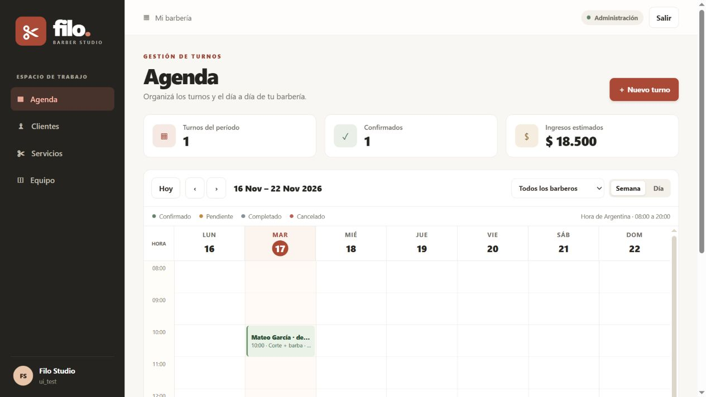

# Filo · Gestión de barbería

Aplicación web para organizar turnos, clientes, servicios y barberos. Desarrollada con **Java, Spring Boot y Angular**, con persistencia en **PostgreSQL**.

## Vista previa



*Captura de la aplicación con datos de demostración.*

## Funcionalidades

- Agenda diaria y semanal, con filtro por barbero.
- Creación, reprogramación y cancelación de turnos.
- Bloqueo de fechas pasadas y de horarios superpuestos, también desde la API.
- Clientes con teléfono, notas e historial de atención.
- Servicios con precio y duración; integrantes del equipo activos o inactivos.
- Login de administrador con contraseñas cifradas, sesiones y protección CSRF.
- Conservación del precio y la duración originales al reprogramar el mismo servicio.

Los horarios se gestionan con la fecha de Argentina, de 08:00 a 20:00. Los ingresos del tablero son estimaciones de turnos, no pagos cobrados.

## Tecnologías

| Capa | Tecnologías |
| --- | --- |
| Backend | Java 21, Spring Boot 3.5, Spring Security, JPA/Hibernate, Bean Validation, Maven |
| Frontend | Angular 21, TypeScript, Signals, Reactive Forms, Router, HttpClient |
| Datos | PostgreSQL 17 y migraciones Flyway |
| Infraestructura | Docker Compose, Nginx y healthchecks |
| Pruebas | JUnit 5, Mockito, Vitest e integración HTTP con PostgreSQL real |

## Ejecutar localmente

Requiere **Docker Desktop** con contenedores Linux y **Docker Compose 2.24.4+**. Desde la carpeta de la aplicación:

```powershell
Copy-Item .env.example .env
```

Editá `.env` y asigná valores propios a `DB_PASSWORD` y `ADMIN_PASSWORD`. La contraseña del administrador debe tener al menos 16 caracteres y no superar 72 bytes UTF-8. Si el archivo ya existe, conservá su configuración.

```powershell
docker compose up --build -d --wait --wait-timeout 180
```

- **Aplicación:** http://localhost:14203
- **API:** http://localhost:18083/api
- **Estado del backend:** http://localhost:18083/actuator/health

Ingresá con el usuario definido en `ADMIN_USERNAME` (por defecto, `admin`) y la contraseña de `.env`. Antes de reservar el primer turno, agregá un cliente, un servicio y un barbero activos. El administrador se crea solo al iniciar una base vacía; cambiar la variable no modifica una contraseña existente.

Los datos se conservan en un volumen de PostgreSQL. Para detener la app sin borrarlos, usá `docker compose stop`. Evitá `docker compose down -v` si querés conservarlos. No subas `.env` ni respaldos de la base a Git.

## Estructura y pruebas

```text
backend/      API REST, reglas de negocio, seguridad y migraciones
frontend/     Aplicación Angular y configuración de Nginx
docs/         Documentación técnica y operación
```

Cada construcción Docker compila ambas aplicaciones y ejecuta sus pruebas unitarias. Las pruebas de integración están escritas en Java y usan un entorno aislado con PostgreSQL. Con Java 21 y Maven instalados:

```powershell
docker compose -p filo-barberia-test -f compose.yaml -f compose.test.yaml up --build -d --wait --wait-timeout 180
mvn -f backend/pom.xml -Phttp-integration verify
docker compose -p filo-barberia-test -f compose.yaml -f compose.test.yaml stop
```

La integración cubre autenticación, CSRF, fechas pasadas, superposiciones, reservas simultáneas, versiones e historial. GitHub Actions incluye este mismo flujo de verificación.

## Alcance y documentación

Esta versión administra una barbería y un administrador. Las reservas públicas, WhatsApp, cobro de señas y múltiples sucursales quedan para futuras versiones. Antes de un despliegue público, configurar HTTPS, cookies seguras, secretos y respaldos.

- [API y reglas de turnos](docs/API.md)
- [Desarrollo, configuración y operación](docs/OPERATIONS.md)
